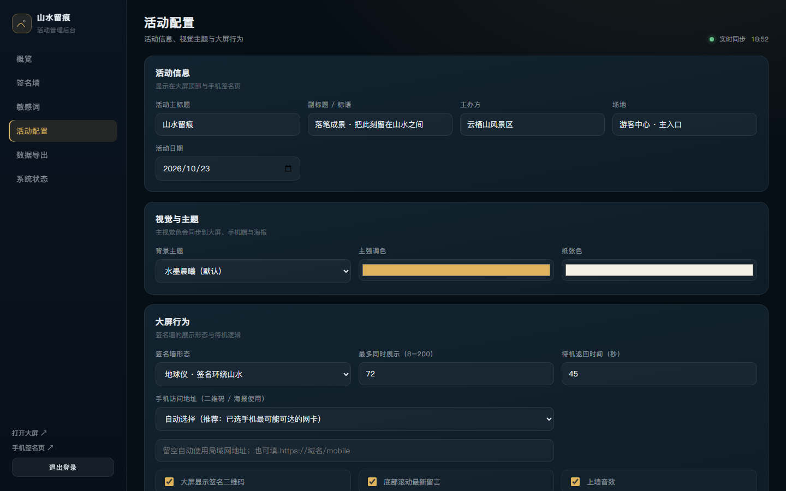

# 使用方快速上手（现场人员版）

> 面向景区现场执行人员。照着做，5 分钟就能把签名墙开起来。
> 更完整的说明见《操作使用手册》，部署与网络问题见《部署文档》。

---

## 一、先认识三个地址

服务启动后，大屏、手机、后台是同一个服务上的三个页面：

| 页面 | 地址 | 谁用 |
| --- | --- | --- |
| 大屏签名墙 | `http://localhost:8080/` | 现场观众触摸签名 |
| 手机签名页 | 扫大屏右下角二维码（地址形如 `http://10.206.118.146:8080/mobile`） | 观众用自己手机签名 |
| 管理后台 | `http://localhost:8080/admin` | 工作人员管理数据 |

> `localhost` 只能在本机用；手机必须用"局域网 IP"（二维码里的那个地址）。

---

## 二、第一次打开（5 步）

### 第 1 步：启动服务

双击 **`启动签名墙.bat`**。

- 会弹出一个黑色窗口，显示"大屏展示 / 手机签名 / 管理后台"三个地址和"二维码地址"。
- **这个黑窗口要一直开着**，关掉就等于关掉服务。
- 若提示"未检测到 Node.js"，先安装 Node.js 18+（安装时勾选 Add to PATH）。

### 第 2 步：打开大屏

双击 **`打开大屏.bat`**，会自动用 Chrome / Edge 全屏打开签名墙。

- 想退出全屏：`Alt + F4`（或 `F` 键切换）。
- 也可以手动打开浏览器，输入 `http://localhost:8080/`，按 `F` 全屏。

### 第 3 步：放行防火墙（手机连不上时做）

双击 **`开放防火墙端口.bat`**，弹出管理员授权点"是"。

- 默认放行 8080 端口；若改过端口，可右键"以管理员身份运行"后拖入参数，或编辑脚本里的 `set PORT=`。
- 现场 Wi-Fi 常被 Windows 识别为"公用网络"，这个脚本会同时放行专用/域/公用三种网络。

### 第 4 步：登录后台，改成自己的活动

双击 **`打开管理后台.bat`**（或浏览器打开 `http://localhost:8080/admin`）：

1. 默认口令 **`admin123`**，登录。
2. 立刻到「系统状态 → 修改管理员口令」改成自己的口令。
3. 「活动配置」填写：主标题、副标题、主办方、场地、日期；选择背景主题与签名墙形态（地球仪 / 星空 / 气泡）。
4. 「敏感词」按需增删（默认已内置常见词库）。
5. 「概览 → 一键清屏」清掉演示数据（会先自动备份到 `data/exports/`）。

> 手机、平板或其他电脑要看后台：连同一 Wi-Fi 后访问 `打开管理后台.bat` 显示的局域网地址（形如 `http://10.206.118.146:8080/admin`）；也可以点后台左下角「其他设备访问 ↗」扫二维码打开。其他设备无需安装任何程序。

### 第 5 步：用手机试一遍

1. 手机连接**与大屏电脑同一个 Wi-Fi**。
2. 扫描大屏右下角二维码。
3. 走一遍：开始签名 → 手写 → 下一步 →（可选拍照）→ 留言 → 预览海报 → 提交上墙。
4. 看大屏是否出现"签名飞入"和新的签名卡。

> 二维码下方显示的 `IP:端口` 就是对外访问地址，可先在手机浏览器里直接输入试一下。

---

## 三、现场怎么用

| 场景 | 怎么做 |
| --- | --- |
| 观众来了 | 触摸大屏任意位置 → 手写 → 可填昵称/留言 →「落笔生花 · 上墙」 |
| 观众想用手机 | 扫码 → 手写 → 生成海报 → 提交；海报可保存/分享 |
| 想看得更清楚 | 点任意签名卡 → 详情大图（含留言、留影）→ 可「打印留念」 |
| 出现不雅留言 | 后台「签名墙」搜索 → 隐藏 / 删除，大屏同步移除 |
| 签名太多太挤 | 后台「活动配置 → 最多同时展示」调小（如 40） |
| 活动结束 | 后台「数据导出」下载 CSV/JSON → 复制整个 `data` 目录留存 → 按需一键清屏 |

大屏无人操作 45 秒（可配置）会自动回到待机画面，并轮播往期签名。

---

## 四、每天怎么开关

- **开始营业**：双击 `启动签名墙.bat` → 双击 `打开大屏.bat` → 后台确认配置。
- **结束营业**：先关闭浏览器全屏，再在黑色窗口按 `Ctrl + C`（数据会自动保存）。
- **第二天**：重复上面两步即可，已上墙数据仍在（除非清屏）。

> 大屏电脑建议关闭系统休眠、屏保与自动更新，避免中途黑屏。

---

## 五、遇到问题先看这三条

**1. 手机扫码打不开**
- 手机与大屏是否同一 Wi-Fi？
- 二维码下方地址是不是 `192.168.189.1` / `192.168.40.1` 这类虚拟网卡地址？是的话，到后台「活动配置 → 对外访问地址」下拉选择 `WLAN` 地址并保存。
- 双击 `开放防火墙端口.bat`；检查路由器是否开启"AP 隔离"。
- 实在不行：让电脑连手机热点，重启服务，二维码会自动变成热点地址。

**2. 大屏白屏 / 打不开**
- 黑色窗口是否还开着？有没有报错？
- 浏览器按 `Ctrl + F5` 强刷；
- 访问 `http://localhost:8080/healthz`，能显示一串 JSON 就说明服务正常。

**3. 签名提交没反应**
- 是否真的写了字（空签名会被拦截）；
- 大屏右上角是否显示"已断开"；
- 手机端弱网会自动暂存并补传，看到"已暂存"不用重复提交。

**4. 手机用 4G / 甲方在异地，扫码打不开**
- 局域网地址只能同网段使用，必须配公网入口。最快方式：先启动服务，再双击 **`启动公网访问.bat`**，等它显示公网地址即可（会自动切换二维码）；
- 关闭该窗口就恢复局域网模式；公网地址每次重启会变。
- 正式活动建议用固定域名，见 `deploy/README.md`。

---

## 六、文件别乱动

| 文件/目录 | 作用 |
| --- | --- |
| `启动签名墙.bat` | 启动服务（每天用） |
| `打开大屏.bat` | 全屏打开大屏（每天用） |
| `打开管理后台.bat` | 打开后台，并自动复制局域网后台地址 |
| `启动公网访问.bat` | 手机 4G / 异地访问时用：自动建立公网隧道并切换二维码 |
| `开放防火墙端口.bat` | 手机连不上时用一次 |
| `data\` | 全部签名、留影、配置、日志（**要备份**） |
| `server\`、`public\` | 程序本体，不要删改 |
| `docs\` | 使用文档 |

备份方法：活动结束后把整个 `data` 文件夹复制到 U 盘/移动硬盘即可。
