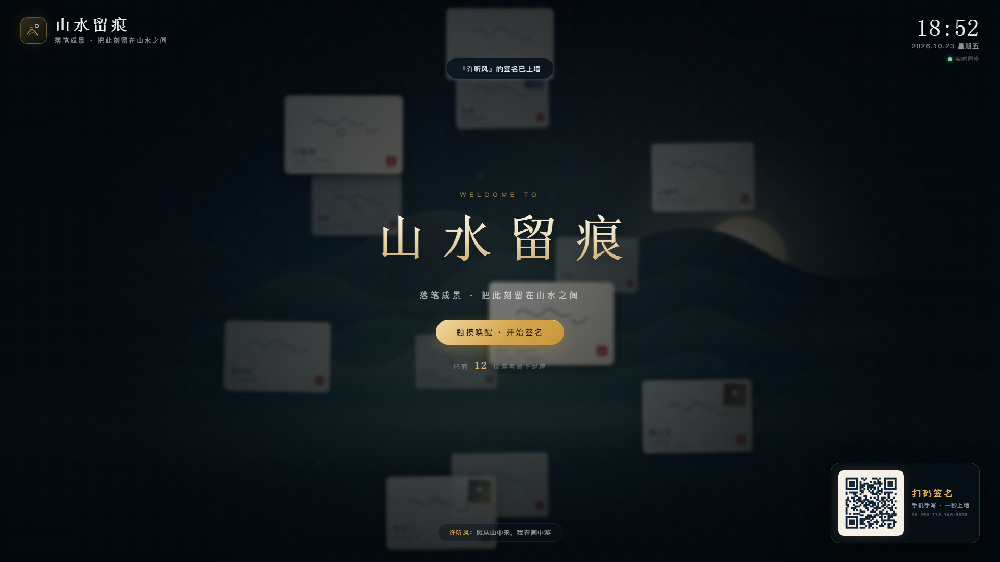
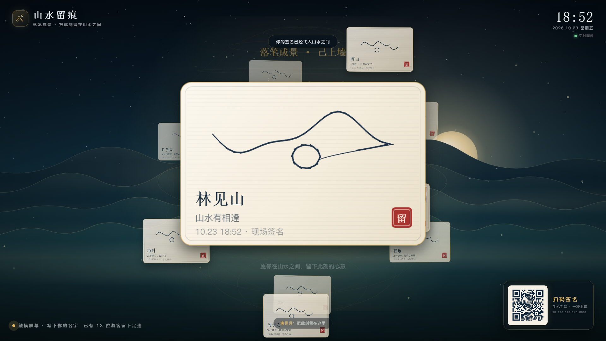
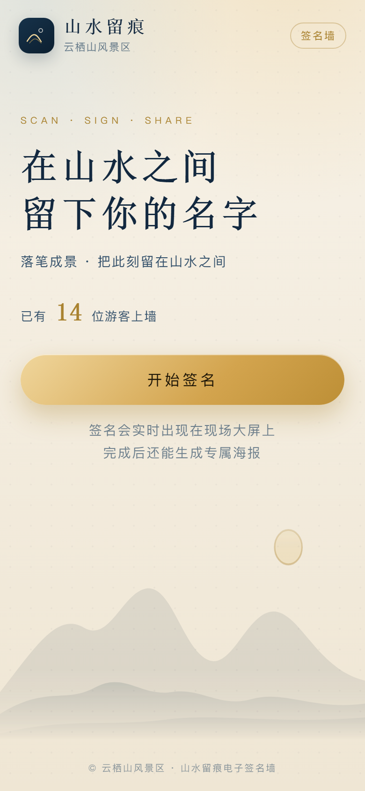
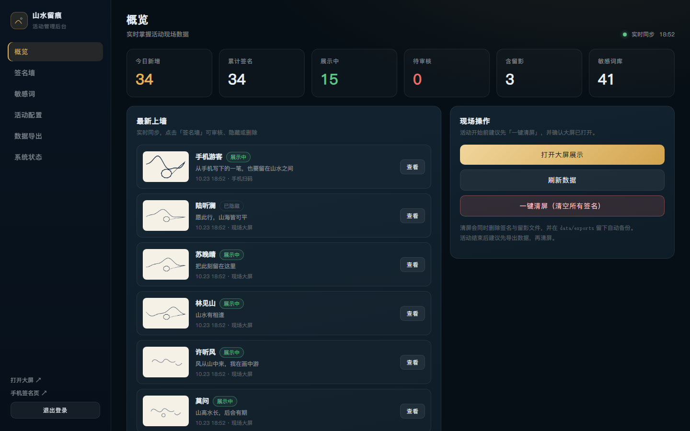
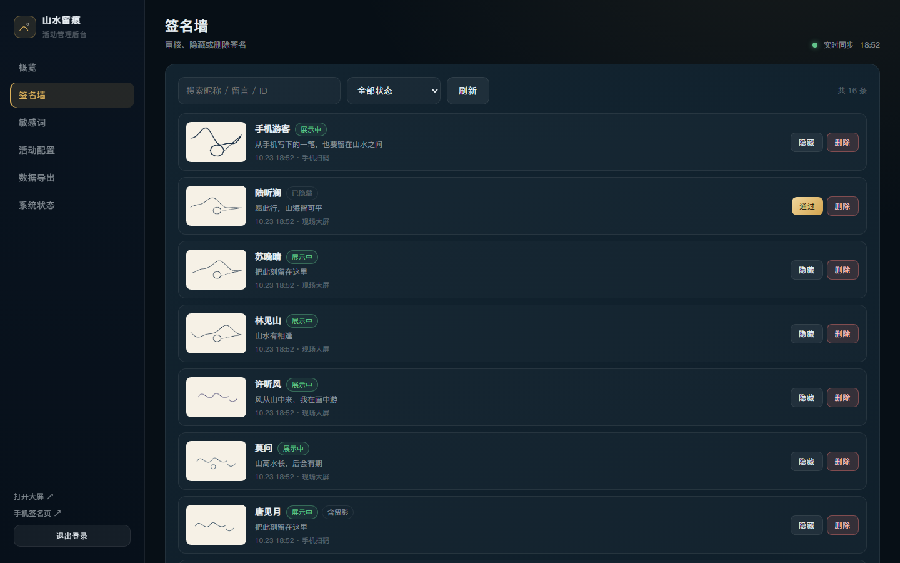

# 操作使用手册

> 适用角色：现场执行人员、活动运营、后台管理员。
> 阅读时间约 10 分钟。建议活动前一天按「4. 活动前检查清单」完整演练一次。

---

## 1. 三个入口

| 入口 | 地址 | 谁用 |
| --- | --- | --- |
| 大屏 | `http://localhost:8080/` | 现场观众触摸签名 |
| 手机端 | `http://<局域网IP>:8080/mobile`（由二维码进入） | 观众用自己手机签名 |
| 后台 | `http://localhost:8080/admin` | 工作人员管理数据 |

大屏待机画面：标题、唤醒按钮、右上角时间与连接状态、右下角签名二维码（二维码下方会显示对外访问地址，便于现场核对）、底部最新留言。

> 待机页的「已有 N 位游客留下足迹」是**当前墙上的签名人数**：有人上墙实时 +1，后台删除 / 隐藏或一键清屏时实时减少（手机端首屏的人数同步更新）。

---

## 2. 大屏操作

### 2.1 开始签名

1. 观众触摸屏幕任意位置，或点击「触摸唤醒 · 开始签名」。
2. 在弹出的签名面板中手写（支持手指、触控笔；有压感时笔画会随力度变粗细）。
3. 可选：选择墨色（墨黑 / 朱砂 / 石青 / 靛蓝）、笔粗（细 / 中 / 粗）、撤销、清空。
4. 可选：填写昵称（不填显示"山水过客"）、留言（≤ 80 字）。
5. 若后台开启"大屏支持拍照留影"，可勾选「拍一张留影」调用摄像头拍照，可重拍。
6. 点击「落笔生花 · 上墙」。签名会先化作墨点粒子汇聚，再飞入签名墙；底部提示"你的签名已经飞入山水之间"。

### 2.2 浏览与详情

- 签名完成后进入浏览状态，所有签名卡片按「地球仪 / 星空 / 气泡」形态漂浮。
- 点击任意卡片 → 打开详情：大图签名、昵称、留言、留影、时间与来源。
- 详情页点「打印留念」→ 弹出 A5 海报打印窗口（需后台开启打印，且系统已装打印机）。
- 点「继续浏览」或空白处关闭；`Esc` 也可关闭。
- 无操作达到「待机返回时间」（默认 45 秒）后自动回到待机画面，并开始轮播往期签名。

### 2.3 快捷键

| 按键 | 作用 |
| --- | --- |
| `F` | 进入 / 退出全屏 |
| `Esc` | 关闭签名 / 详情 / 相机面板 |
| `F5` | 刷新页面（数据不会丢） |

### 2.4 状态灯（右上角）

| 状态 | 含义 |
| --- | --- |
| 绿点 · 实时同步 | WebSocket 正常，手机与大屏实时联动 |
| 黄点 · 正在重连 | 网络抖动，正在自动恢复，无需操作 |
| 红点 · 已断开 | 持续 10 秒以上仍在重连，检查网络与服务 |

### 2.5 二维码地址核对（活动前必做）

1. 看大屏右下角二维码下方显示的地址，例如 `10.206.118.146:8080`。
2. 用手机（连现场 Wi-Fi）打开 `http://10.206.118.146:8080/mobile`，能出现签名首页即正常。
3. 打不开时：
   - 后台「活动配置 → 对外访问地址」下拉切换到 `WLAN` / "以太网"地址并保存（默认已自动避开 VMware / Hyper-V 虚拟网卡）；
   - 双击 `开放防火墙端口.bat` 放行端口；
   - 检查路由器是否开了"AP 隔离"、手机是否连的是 5G 访客网络等不同网段。

> 现场电脑若装有 VMware、Hyper-V、Docker 等，系统会多出 `192.168.189.1`、`192.168.40.1`、`172.x.x.x` 等虚拟网卡。二维码必须指向手机可达的 Wi-Fi 地址，后台下拉框里标了"虚拟网卡"的选项不要选。

---

## 3. 手机端操作

观众扫码后进入 H5，无需关注、无需登录。

| 步骤 | 操作 | 说明 |
| --- | --- | --- |
| 1 | 开始签名 | 首屏显示活动信息与当前上墙人数 |
| 2 | 手写签名 | 写完点「下一步」；可换墨色、笔粗、撤销、清空 |
| 3 | 拍照留影（可选） | 「打开相机」实时拍摄，或「从相册选择」；拍完显示预览 |
| 4 | 昵称与留言 | 可点快捷短语追加；留言会做敏感词处理 |
| 5 | 确认上墙 | 自动生成 1080×1440 专属海报，确认后提交 |
| 6 | 完成 | 显示"已上墙"与海报，可「保存海报到相册」「分享给朋友」「再签一个」 |

**保存海报**：Android / 桌面浏览器会直接下载 PNG；iPhone 建议长按海报 → 存储到照片（按钮也会提示）。

**网络不稳**：提交失败会自动暂存，恢复后自动补传，不会重复上墙；页面提示"已暂存"时无需重复提交。

**相册/相机权限**：若网页相机被浏览器拒绝，请使用「从相册选择」（会调起系统相机）。

---

## 4. 管理后台

登录：双击 `打开管理后台.bat`（自动使用本机局域网地址并复制到剪贴板），或浏览器打开 `http://localhost:8080/admin`，默认口令 `admin123`。首次登录请立即修改。

其他设备（手机 / 平板 / 另一台电脑）与服务器连同一局域网后，访问 `http://<服务器IP>:8080/admin` 即可，无需安装程序；也可点后台左下角「其他设备访问 ↗」扫二维码打开。

### 4.1 概览

- 今日上墙 / 累计签名 / 展示中 / 待审核 / 含留影 / 敏感词库。
- 最新上墙列表：可「查看」→ 打开该签名的打印海报页。
- 现场操作：打开大屏、刷新数据、一键清屏。
- 右上角显示实时连接状态。

### 4.2 签名墙

- 按状态筛选（全部 / 展示中 / 待审核 / 已隐藏），可按昵称、留言、ID 搜索。
- 操作：
  - **通过**：待审核签名上墙。
  - **隐藏**：从大屏移除，但保留数据。
  - **删除**：连同签名图片、留影一起删除，不可恢复。

### 4.3 敏感词

- 命中规则：忽略全角 / 空格 / 符号 / 零宽字符（"傻 逼""Ｓ Ｂ"都能识别）。
- 命中策略在「活动配置 → 审核设置」中设置：自动打码 或 直接拒收。
- 支持单个添加、批量导入（换行或逗号分隔）、删除、导出词库文件。

### 4.4 活动配置

| 区块 | 关键项 | 说明 |
| --- | --- | --- |
| 活动信息 | 主标题、副标题、主办方、场地、日期 | 同步到大屏、手机、海报 |
| 视觉与主题 | 背景主题、强调色、纸张色 | 实时生效，无需刷新 |
| 大屏行为 | 墙形态、展示数量、待机秒数、二维码、留言条、音效 | 保存后大屏立即更新 |
| 互动设置 | 大屏拍照、打印、允许留言 | 关闭后对应入口隐藏 |
| 审核设置 | 自动通过、敏感词策略、长度限制 | 关闭自动通过后签名进入待审核 |
| 手机地址 | 二维码 / 海报的访问地址 | 默认自动选择 Wi-Fi 地址；多网卡时按需在下拉框切换 |

### 4.5 数据导出

- **CSV**：Excel 直接打开（已处理 BOM 与公式注入），字段含 ID / 昵称 / 留言 / 图片路径 / 来源 / 状态 / 命中词 / 时间。
- **JSON**：完整字段，适合二次分析或归档。
- 媒体文件在 `data/media/`，与导出的表格一起拷贝即完成归档。

### 4.6 系统状态

- 运行时长、Node 版本、平台、内存、WebSocket 连接数（大屏/手机/后台）、数据目录、媒体占用、局域网地址。
- **修改管理员口令**：输入当前口令 + 新口令（≥ 8 位）两次。

### 4.7 一键清屏

「概览 → 一键清屏」需要输入 `CLEAR` 确认：

- 删除所有签名与媒体文件，大屏立即清空；
- 自动备份到 `data/exports/before-clear-<时间戳>.json`；
- 累计计数保留（便于活动统计）。

---

## 5. 活动流程建议

### 活动前（T-1 天）

1. 按《部署文档》完成安装，确认 `http://localhost:8080/healthz` 正常。
2. 修改后台口令；填写活动标题、主办方、场地、日期；选择主题与墙形态。
3. 用 3 台不同品牌手机走通：扫码 → 签名 → 留言 → 拍照 → 提交 → 存海报。
4. 用大屏走通：签名 → 上墙 → 点卡片 → 打印留念（试打一张）。
5. 一键清屏，清掉测试数据；确认待机画面与二维码地址正确。
6. 大屏浏览器设为全屏/kiosk，关闭休眠、屏保、系统更新。

### 活动中

- 大屏保持待机，观众触摸即签；手机签名会实时飞入。
- 若出现不雅留言：后台「签名墙」搜索 → 隐藏/删除，大屏同步移除。
- 若签名过多导致拥挤：后台把「最多同时展示」调小，老签名自动退出视野（数据仍在）。
- 待审核模式下，后台收到新签名提示后及时审核。

### 活动后

1. 后台「数据导出」下载 CSV 与 JSON。
2. 复制整个 `data` 目录归档（含媒体与日志）。
3. 按需一键清屏，为下一场活动复用设备。
4. 关闭服务（终端 `Ctrl+C`，会自动落盘）。

---

## 6. 常见问题

**Q：观众说手机打不开二维码链接。**
A：按顺序排查：
1. 手机与大屏是否连同一个 Wi-Fi；
2. 看大屏二维码下方显示的地址（例如 `10.206.118.146:8080`），把这一串直接输入手机浏览器试一次；
3. 如果地址是 `192.168.x.x` 但手机连的是另一个网段，或电脑装了 VMware / Hyper-V（会出现 `192.168.189.1`、`192.168.40.1` 这类地址），请到后台「活动配置 → 对外访问地址」下拉选择 `WLAN` 或"以太网"对应的地址并保存，大屏二维码会自动刷新；
4. 仍打不开：双击 `开放防火墙端口.bat` 放行端口（会弹管理员授权），确认路由器没有开启"AP 隔离"；
5. 手机浏览器提示"无法访问此网站"通常是网络/防火墙问题；提示"页面不存在"则是端口后面的路径写错，请使用二维码而非手动输入残缺地址。

**Q：手机用 4G、或甲方在另一个城市，扫码能打开吗？**
A：默认的局域网地址不行，必须有公网入口。三种做法：
1. **最快**：先启动服务，再双击 `启动公网访问.bat`，约 10 秒后窗口显示公网地址，二维码自动切换；关闭窗口自动恢复局域网模式（需要现场能上外网）；
2. 部署到公网服务器（域名 + HTTPS），按 `deploy/README.md` 操作；
3. 手动用内网穿透（ngrok / frp / Cloudflare Named Tunnel），拿到地址后填入后台「活动配置 → 对外访问地址」。

保存后大屏二维码、海报二维码、后台「其他设备访问」二维码都会自动切换为该公网地址，任何网络都能扫码使用。

> 注意：隧道窗口要**按 Ctrl+C 正常结束**。若直接点窗口关闭，后台可能残留一个已失效的公网地址（手机打开会显示 530）。本版服务端会自动探测，连续失败约 2–3 分钟后恢复局域网地址；也可以在后台把「对外访问地址」清空立即恢复，再重新运行 `启动公网访问.bat` 获取新地址。

**Q：签名写完点提交没反应。**
A：先看是否真的写了字（空签名会提示）；再看大屏右上角是否"已断开"；手机端网络差时看是否有"已暂存"提示。

**Q：签名墙上的字太小 / 太挤。**
A：后台「最多同时展示」调小（如 30–50），卡片会自动放大；也可切换展示形态。

**Q：能不能只显示审核过的留言？**
A：可以。后台关闭「自动通过」，签名进入待审核，人工「通过」后才上墙。

**Q：换主题后大屏没变化？**
A：配置保存后会自动推送；若大屏网络断开，重连后自动同步，或按 F5 刷新。

**Q：海报上的二维码指向哪里？**
A：指向手机签名页（默认自动取局域网地址，或后台填写的「对外访问地址」）。活动结束后二维码仍可打开页面，但活动配置应保持到传播周期结束。

**Q：打印出来的海报没有背景？**
A：打印对话框中勾选"背景图形"（Background graphics），并选择"无边距/最小边距"。

**Q：误删了签名怎么办？**
A：删除不可恢复；但若刚刚执行过"一键清屏"，可在 `data/exports/before-clear-*.json` 中找到记录（媒体文件需另行备份）。建议活动期间谨慎使用删除。

---

## 7. 紧急处理

| 情况 | 处理 |
| --- | --- |
| 大屏白屏 | `Ctrl+F5` 强制刷新；仍不行则重启服务并刷新 |
| 大屏卡顿 | 后台降低展示数量；关闭其他程序；按 `F` 重新全屏 |
| 网络断开 | 页面会自动重连；签名数据在本地，恢复后继续 |
| 服务进程退出 | 重新双击 `启动签名墙.bat`，数据从 `data/db.json` 恢复 |
| 电脑重启 | 重新启动服务与浏览器全屏即可，已上墙数据仍在 |
| 需要临时停止收集 | 后台「一键清屏」或关闭自动通过，改为人工审核 |
